# Tests du projet

Les captures d’écran ci-dessous montrent les commandes exécutées et leurs résultats.

## T1 Sans argument ou option inconnue

### Lancement sans argument

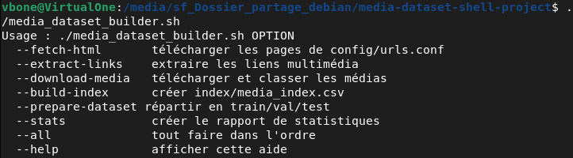

### Option inconnue

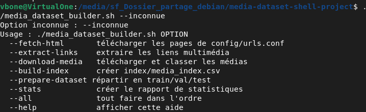

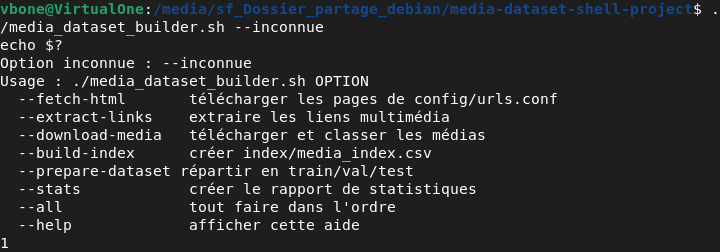

### Vérification avec l’option `--stats`

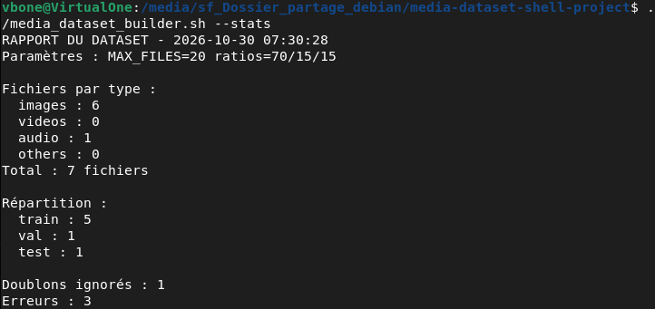

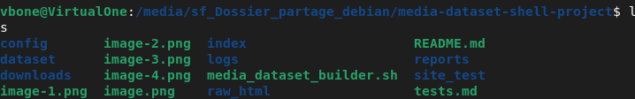

## T2 Ratios dont la somme ne vaut pas 100

La valeur de `TEST_RATIO` a été remplacée provisoirement par `20`, puis remise à `15`.

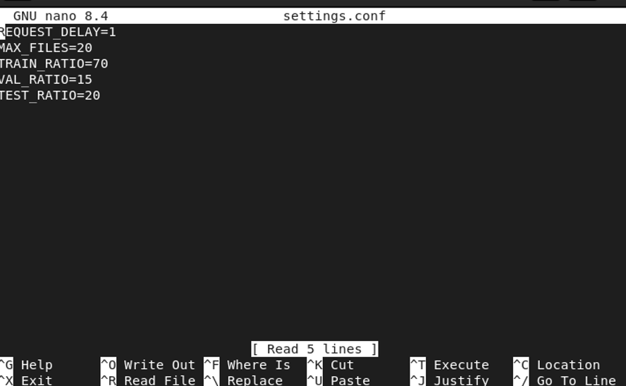

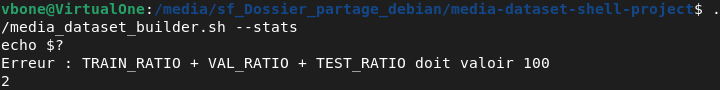

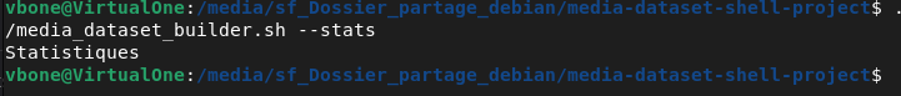

La configuration a ensuite été remise à sa valeur initiale.

### Vérification de `MAX_FILES`

La variable a été affichée temporairement dans la fonction `statistiques`, puis la ligne de test a été retirée.

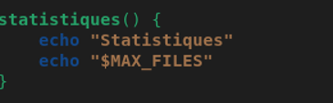

## T3 Page absente

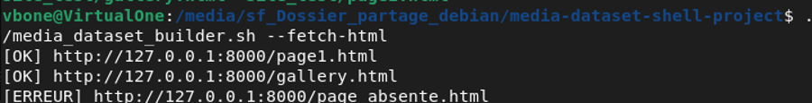

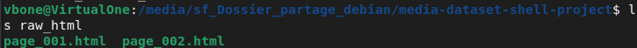

Le journal contient deux lignes `INFO` et une ligne `ERROR`.

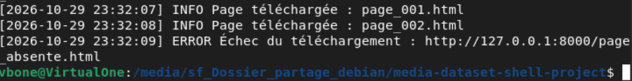

Serveur arrêté avec `Ctrl+C` : les trois téléchargements échouent. Le serveur est ensuite relancé.

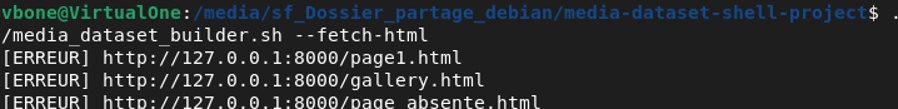

## T4 Lien répété, PDF et lien relatif

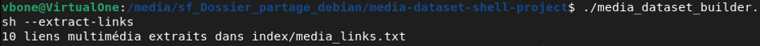

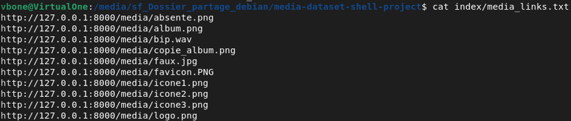

## T5 Fichier `faux.jpg`

## T6 Doublon `copie_album.png`

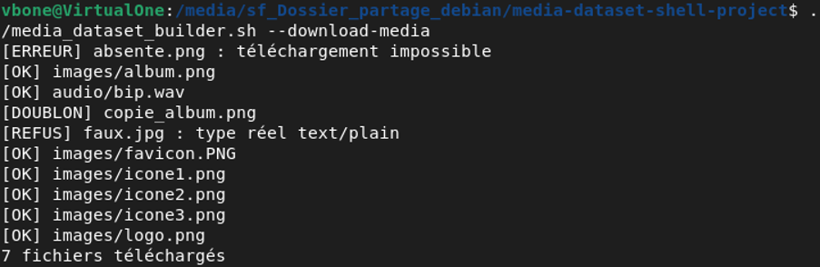

## T7 `MAX_FILES=3`

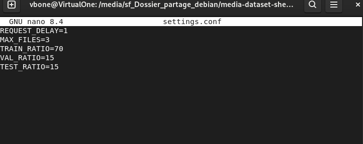

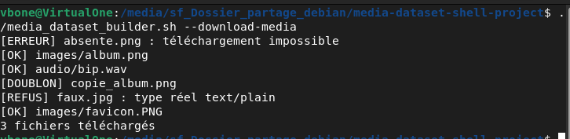

## T8 Serveur arrêté avec `--all`

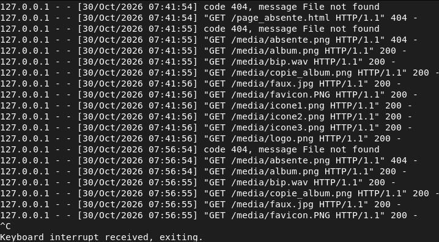

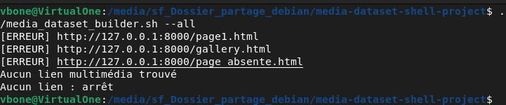

